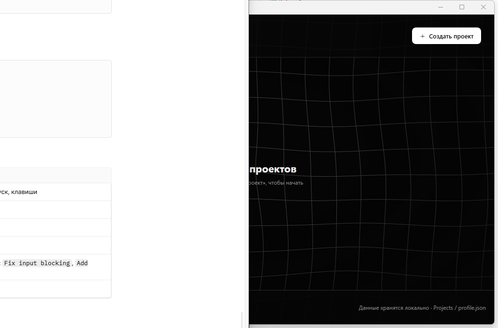
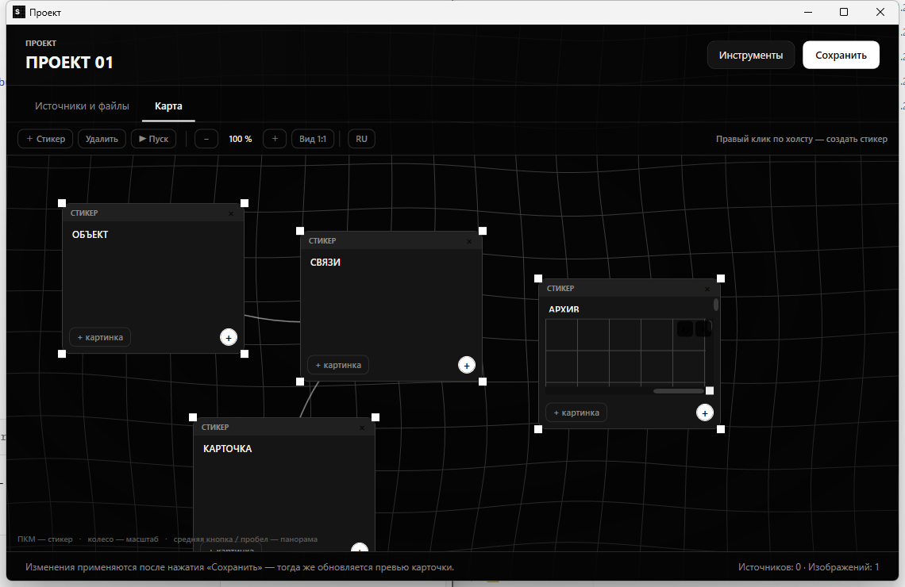

# Sweetheart OSINT

Локальное WPF-приложение (.NET 8, x64) для ведения OSINT-проектов: карточки проектов, источники, заметки, изображения, полноценный динамический редактор карты и быстрый доступ к полезным сервисам. Интерфейс выполнен в монохромной чёрно-белой палитре с анимированным фоном «искажённая сетка».

Инструкция по публикации на GitHub и созданию релиза: [GITHUB.md](GITHUB.md). Готовый текст релиза: [RELEASE_NOTES.md](RELEASE_NOTES.md).

## Запуск

Готовый автономный файл (создаётся командой `publish` из раздела «Сборка из исходников»):

```
publish\win-x64\SweetheartOSINT.exe
```

Это self-contained single-file сборка: .NET на компьютере устанавливать не нужно. При первом запуске рядом с `.exe` появятся папка `Projects` и (после сохранения профиля) файл `profile.json`.

Альтернативная облегчённая сборка:

```
SweetheartOSINT\bin\x64\Release\net8.0-windows\SweetheartOSINT.exe
```

Для неё требуется установленный **.NET 8 Desktop Runtime (x64)**.

## Скриншоты





## Что внутри

- **Главное меню** — сетка карточек проектов с автоматической раскладкой. На карточке: название, процент с полосой прогресса и превью содержимого проекта. При наведении появляется корзина — удаляет проект вместе с его папкой после подтверждения.
- **Иконка приложения** — монохромная «S» на сетке; используется и для exe, и для всех окон.
- **Создание проекта** — окно с вводом названия и процента (0–100). Кнопка «Создать проект» в правой части шапки.
- **Окно проекта**
  - параметры: название и процент (можно изменить);
  - источники: ссылки и текстовые заметки, добавление, открытие ссылки в браузере, удаление;
  - галерея: добавление PNG/JPG/GIF/BMP/WebP, удаление изображений;
  - «Карта» — вкладка с пустым холстом и редактором стикеров;
  - «Сохранить» — записывает данные, пересоздаёт превью и возвращает в главное меню;
  - «Инструменты» — боковая панель со ссылками на сервисы.
- **Профиль** (левый нижний угол главного меню) — ник и круглая аватарка; сохраняется в `profile.json`. Если аватарки нет, показываются инициалы.
- **Фон** — общий для всех окон `WarpedGridBackground`: чёрный фон, тонкие серые кривые Безье, медленный дрейф по X/Y и пульсация прозрачности. Слой не перехватывает клики.

### Редактор карты

Редактор сделан на чистом WPF без сторонних библиотек: `ItemsControl` с `Canvas` в качестве панели, `MatrixTransform` для масштаба и панорамы, `Path` с кривыми Безье для связей. При открытии вкладки «Карта» холст **пустой** — готовых узлов и демо-данных нет.

- **Создание**: правый клик по холсту → «Создать стикер», либо кнопка «＋ Стикер» на панели инструментов.
- **Стикер**: прямоугольник с закруглёнными углами; текст редактируется прямо внутри; перетаскивается мышью; растягивается за четыре угла; удаляется кнопкой «×», кнопкой «Удалить» на панели или клавишей `Delete`.
- **Картинка**: кнопка «+ картинка» внутри стикера открывает диалог выбора файла; на стикер также можно перетащить файл изображения мышью. Файл копируется в папку `images` проекта. Большое изображение не вписывается насильственно: внутри стикера есть горизонтальная и вертикальная прокрутка, кнопка `↻` поворачивает картинку на 90°, `×` убирает её.
- **Источники**: белый кружок «+» в правом нижнем углу стикера — клик добавляет строку со ссылкой (открыть ↗, удалить ×); если от того же «+» протянуть линию к другому стикеру, создаётся связь кривой Безье.
- **Связи** пересчитываются при перемещении или изменении размера любого из связанных стикеров. Правый клик по стрелке открывает меню «Удалить связь»; зона попадания расширена, поэтому цель попадается легко.
- **Язык ввода**: кнопка `RU`/`EN` на панели переключает русский и английский одним кликом — двойное нажатие `Shift+Alt` в Windows не требуется.
- **Навигация**: колесо мыши или кнопки «−» / «＋» меняют масштаб, «Вид 1:1» сбрасывает масштаб и панораму; средняя кнопка мыши или `Space` + перетаскивание двигают весь холст (левая кнопка для панорамы не используется).

### Воспроизведение «Пуск»

Кнопка `▶ Пуск` запускает кинематографичную анимацию создания карты. Во время воспроизведения редактор заблокирован, кнопка превращается в `■ Стоп` (можно также нажать `Esc`).

- Холст очищается, камера приближается к первому стикеру, стикер появляется с масштабированием, текст печатается по символам.
- Стикеры появляются по порядку; если их больше пяти, они разбиваются на группы по три и обрабатываются одновременно — с отдельным курсором на каждый стикер.
- У стикера с картинкой работают два курсора одновременно: один печатает текст, второй добавляет изображение и прокручивает его до нужного фрагмента.
- Связи проявляются отдельной анимацией после появления стикеров; в конце камера плавно возвращается к исходному виду.
- Звуки: короткие системные сигналы при появлении стикера, завершении текста, добавлении картинки и связей.
- Анимации текста, появления стикера, вращения/прокрутки картинки и камеры идут независимо друг от друга.

После завершения (или остановки) исходное состояние стикеров, связей и вида холста восстанавливается из снимка — данные проекта не изменяются.

Всё состояние редактора хранится в `CanvasEditorViewModel`: список стикеров, список связей, масштаб и смещение.

### Инструменты

| Сервис | Назначение | Ссылка |
| --- | --- | --- |
| Sherlock | поиск по нику | https://github.com/sherlock-project/sherlock |
| WhatsMyName | поиск по нику | https://whatsmyname.app/ |
| Epieos | поиск по email/телефону | https://epieos.com/ |
| Have I Been Pwned | проверка утечек | https://haveibeenpwned.com/ |
| Whois | домены | https://who.is/ |
| Wayback Machine | архивы | https://web.archive.org/ |

Ссылки открываются в браузере по умолчанию.

## Хранение данных

Все пути указаны относительно папки с исполняемым файлом:

```
SweetheartOSINT.exe
profile.json                     <- ник и файл аватарки
avatar.png                       <- скопированная аватарка (если загружена)
Projects\
  <id-проекта>\
    project.json                 <- название, процент, источники, стикеры, связи, вид холста
    preview.png                  <- превью 520x320
    images\
      <guid>.png                 <- изображения проекта и стикеров
```

В `project.json` редактор записывает:

- `Stickers` — `Id`, координаты `X`/`Y`, размеры `Width`/`Height`, `Text`, `ImageFile`, `ImageRotation` и `Sources` (`Id`, `Url`);
- `StickerLinks` — `Id`, `FromId`, `ToId`;
- `CanvasViewport` — `Zoom`, `OffsetX`, `OffsetY`.

При запуске приложение сканирует `Projects` и загружает все найденные `project.json`; отсутствующие поля редактора инициализируются пустыми значениями. Превью создаётся программно при каждом сохранении: отдельный визуальный узел WPF рендерится через `RenderTargetBitmap` в PNG (используются только стандартные `System.Windows.Media.Imaging`).

## Сборка из исходников

Нужен **.NET 8 SDK** (проверено на 8.0.428).

Обычная сборка Release x64:

```
dotnet build SweetheartOSINT\SweetheartOSINT.csproj -c Release -p:Platform=x64
```

Автономный single-file exe:

```
dotnet publish SweetheartOSINT\SweetheartOSINT.csproj -c Release -p:Platform=x64 -r win-x64 --self-contained true -p:PublishSingleFile=true -p:IncludeNativeLibrariesForSelfExtract=true -o publish\win-x64
```

## Структура проекта

```
SweetheartOSINT\
  App.xaml, App.xaml.cs          запуск и общая обработка ошибок
  Themes\Styles.xaml             монохромная тема, карточки, кнопки, вкладки
  Models\                        ProjectData, SourceItem, UserProfile, ToolLink,
                                 Sticker, StickerSource, StickerLink, CanvasViewport
  Services\
    StorageService.cs            JSON, папки проектов, импорт картинок, профиль
    PreviewService.cs            рендер превью через RenderTargetBitmap
  Converters\Converters.cs       загрузка файловых изображений, видимость
  Views\
    MainWindow.xaml(.cs)         меню, сетка карточек, профиль
    CreateProjectWindow.xaml(.cs)
    ProjectWindow.xaml(.cs)      источники, галерея, инструменты, вкладка «Карта»
    ProfileWindow.xaml(.cs)
    PreviewVisual.xaml(.cs)      визуальный шаблон для превью
    WarpedGridBackground.xaml(.cs)  анимированная сетка на фоне всех окон
    CanvasEditorView.xaml(.cs)   холст, стикеры, связи, жесты мыши
    CanvasEditorView.Playback.cs анимация «Пуск», курсоры, камера, звуки
  ViewModels\
    CanvasEditorViewModel.cs     стикеры, связи, масштаб, сохранение в проект
    StickerViewModel.cs          геометрия, текст, картинка, источники стикера
    StickerSourceViewModel.cs    строка ссылки стикера
    StickerLinkViewModel.cs      геометрия кривой Безье
    RelayCommand.cs              MVVM-команда
```
